# Lodestone — architecture en schémas

Vue d'ensemble visuelle du backend. Les images sont générées à partir de sources
[Mermaid](https://mermaid.js.org/) rangées dans [`diagrams/`](diagrams/) : pour modifier un
schéma, éditer le fichier `.mmd` correspondant puis régénérer les images avec
`sh docs/diagrams/render.sh`.

Sommaire :

1. [Vue d'ensemble](#1-vue-densemble)
2. [Crates du workspace](#2-crates-du-workspace)
3. [Couches du backend](#3-couches-du-backend)
4. [Modèle de données](#4-modèle-de-données)
5. [Authentification](#5-authentification)
6. [Rôles et autorisations](#6-rôles-et-autorisations)
7. [Documents et ingestion](#7-documents-et-ingestion)
8. [Chat RAG en streaming](#8-chat-rag-en-streaming)
9. [Plans, quotas et facturation](#9-plans-quotas-et-facturation)
10. [Comptes et RGPD](#10-comptes-et-rgpd)
11. [Déploiements](#11-déploiements)

---

## 1. Vue d'ensemble

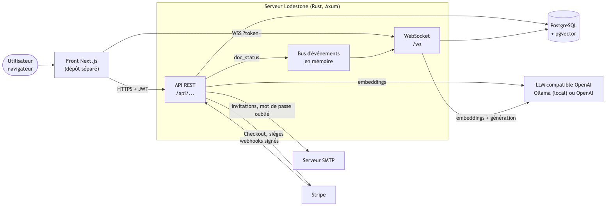

- **Une seule base** pour les données relationnelles ET les vecteurs (pgvector).
- **Le LLM est interchangeable par configuration** : Ollama en local (mode souverain) ou OpenAI.
- **Stripe et SMTP sont facultatifs** : sans eux, la facturation est désactivée et aucun e-mail ne part.

---

## 2. Crates du workspace

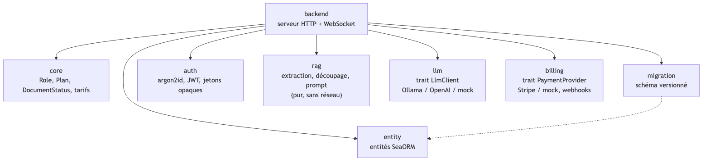

Les crates `rag`, `llm` et `billing` ne connaissent ni Axum ni la base : elles se testent
seules, et `llm` / `billing` exposent un **mock** utilisé par les tests d'intégration.

---

## 3. Couches du backend

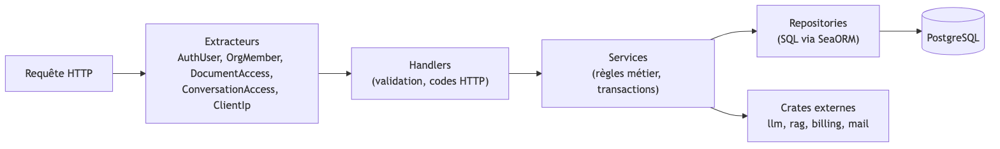

- **L'autorisation vit dans les extracteurs** : un handler qui reçoit un `OrgMember<Admin>`
  sait déjà que l'appelant est admin de l'org de l'URL.
- **Une erreur unique** (`AppError`) donne une réponse JSON `{ "error", "code" }`.

---

## 4. Modèle de données

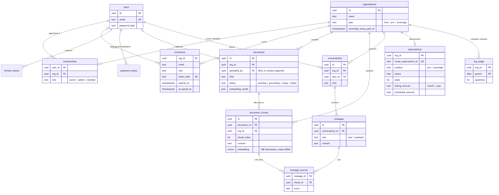

Règles de suppression importantes :

- supprimer une **org** supprime en cascade ses documents, fragments, conversations,
  invitations, abonnement et compteurs ;
- supprimer un **compte** supprime ses sessions, appartenances et conversations, mais
  **ses documents et invitations restent à l'org** (auteur mis à `NULL`).

---

## 5. Authentification

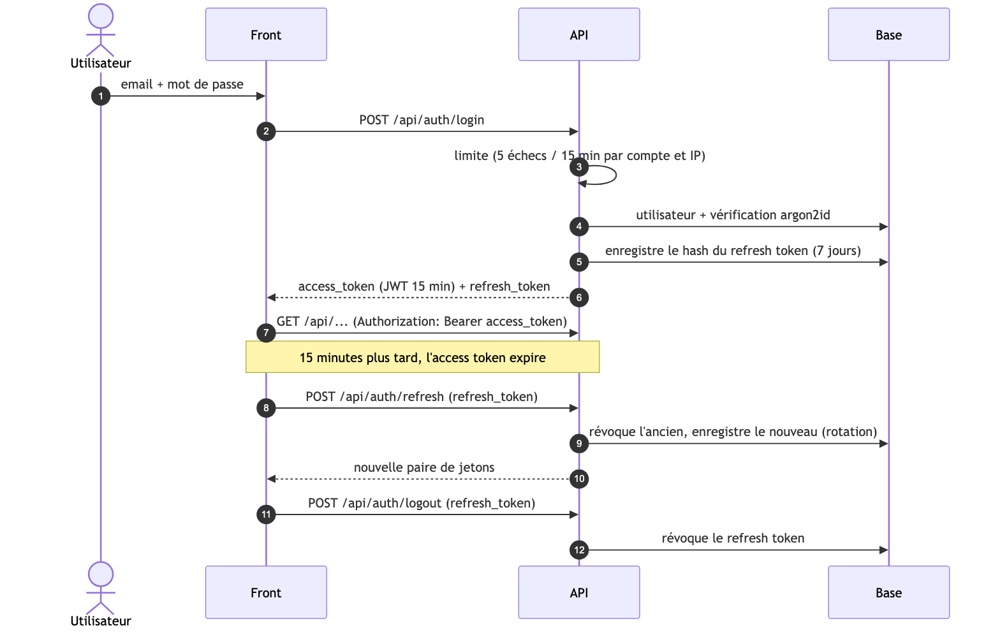

---

## 6. Rôles et autorisations

| Action | owner | admin | member | non-membre |
|---|:---:|:---:|:---:|:---:|
| Voir l'org, ses membres, ses documents, sa consommation | ✅ | ✅ | ✅ | 404 |
| Poser des questions, gérer **ses** conversations | ✅ | ✅ | ✅ | 404 |
| Renommer l'org | ✅ | ✅ | 403 | 404 |
| Uploader / supprimer des documents | ✅ | ✅ | 403 | 404 |
| Inviter (rôle `member`) / retirer un membre | ✅ | ✅ | 403 | 404 |
| Inviter en `admin`/`owner`, changer un rôle | ✅ | 403 | 403 | 404 |
| Voir la facturation | ✅ | ✅ | 403 | 404 |
| Souscrire, changer de périodicité | ✅ | 403 | 403 | 404 |
| Supprimer l'org | ✅ | 403 | 403 | 404 |

Un non-membre reçoit **404** (et non 403) : on ne révèle pas l'existence de l'org.
Une conversation est **privée à son auteur** : même l'owner reçoit 404.

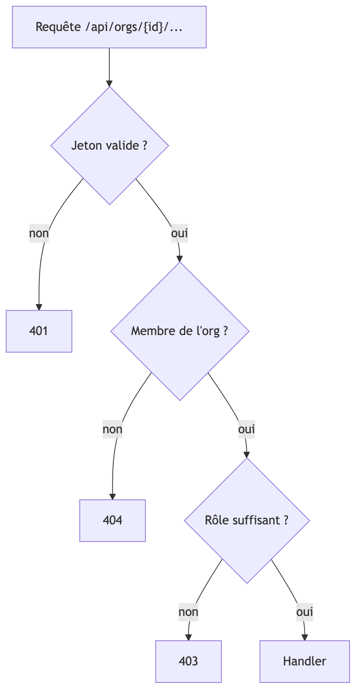

---

## 7. Documents et ingestion

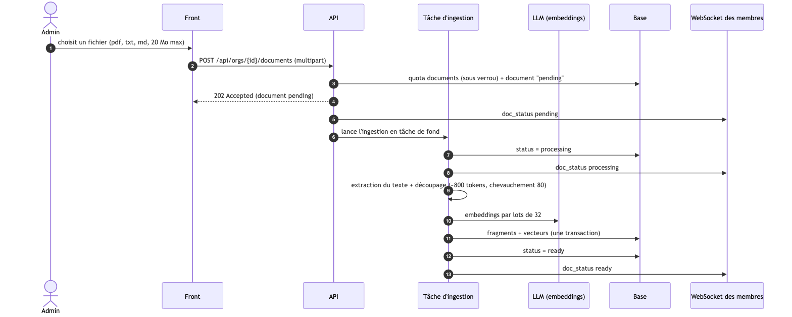

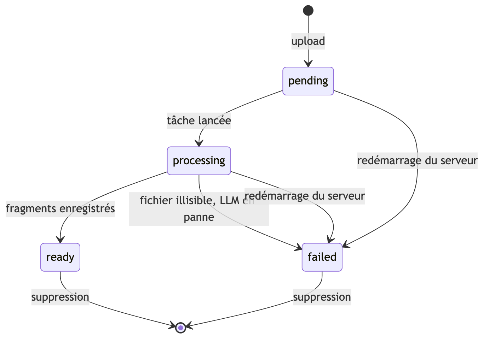

---

## 8. Chat RAG en streaming

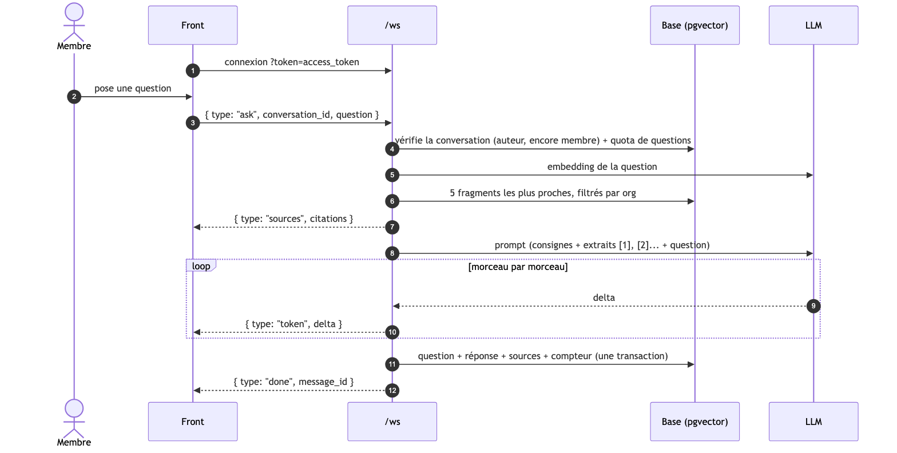

- Sans document pertinent, la réponse est fixe et **le modèle n'est pas appelé** (pas d'invention).
- Une erreur (modèle indisponible, quota atteint…) donne `{ type: "error", message }` et
  **rien n'est enregistré** ; la connexion reste ouverte.
- Une seule question à la fois par connexion ; la génération s'arrête si le client part.

---

## 9. Plans, quotas et facturation

| | Free | Pro | Sovereign |
|---|---|---|---|
| Membres | 3 (invitations en attente comprises) | illimité (facturé au siège) | illimité |
| Documents | 50 | illimité | illimité |
| Questions / mois | 100 | illimité | illimité |
| Orgs possédées | 1 | — | — |
| Prix HT | 0 € | max(149 €, sièges × 29 €) par mois, −15 % à l'année | 18 000 €/an + 6 000 € de mise en service |

Dépassement d'un quota : **402** avec `{ "quota": { "resource", "limit", "plan", "upgrade_to": "pro" } }`.

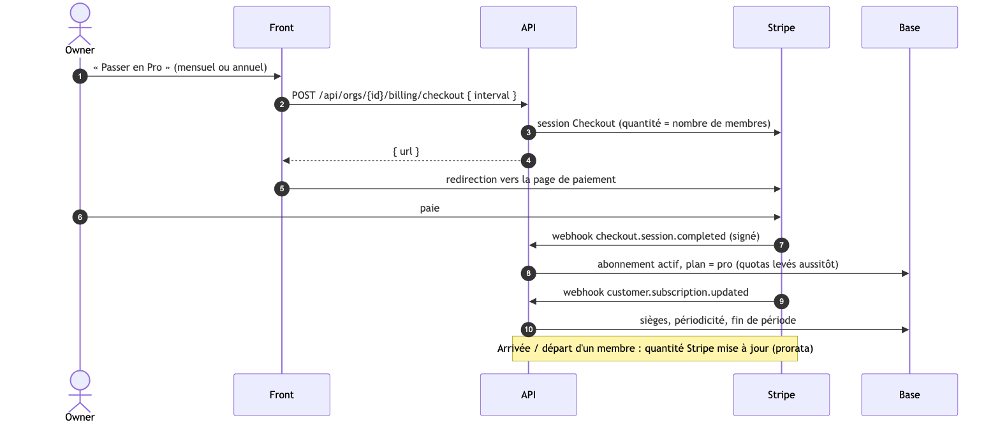

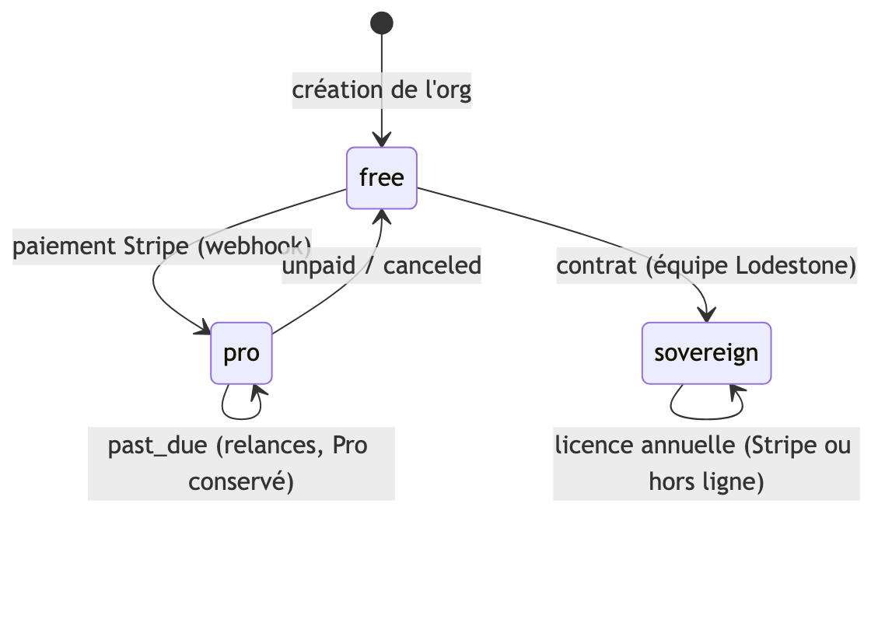

---

## 10. Comptes et RGPD

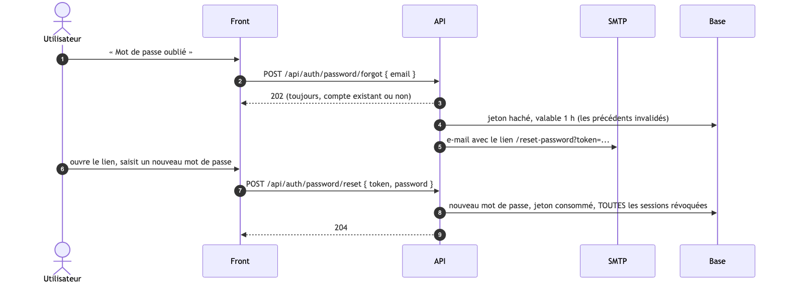

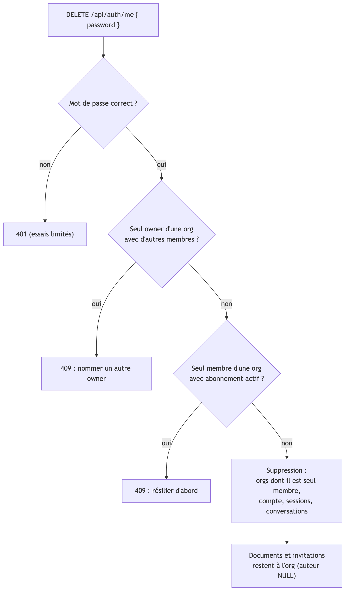

---

## 11. Déploiements

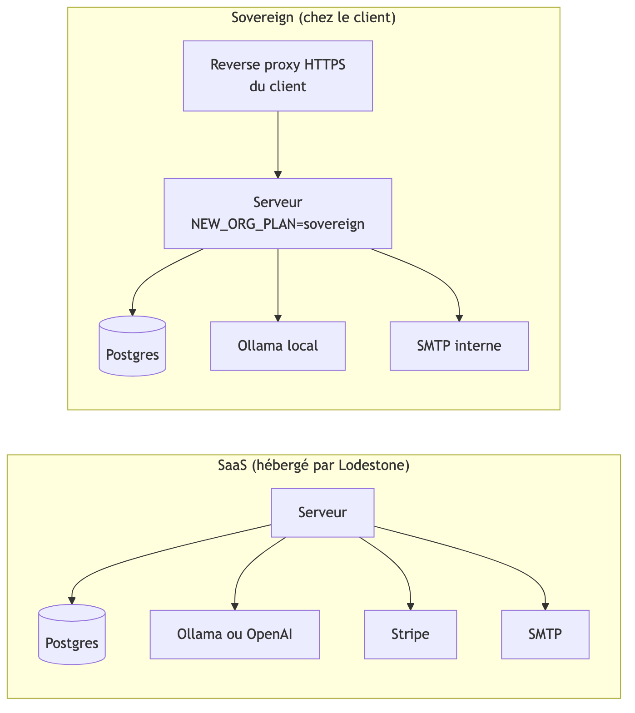

En Sovereign, **rien ne sort du réseau du client** : pas d'OpenAI, pas de Stripe.
Voir [`deploiement-sovereign.md`](deploiement-sovereign.md).
